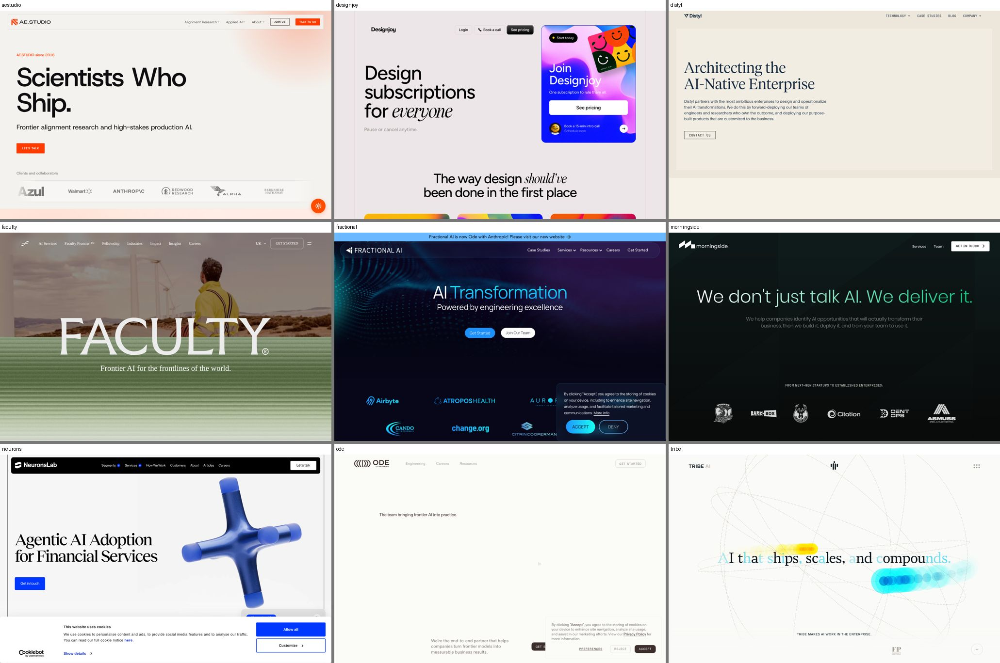

# Referentes mundiales en soluciones de IA a medida

Objetivo: ver qué hacen bien los mejores para copiar la estructura de nuestra web y nuestro mensaje. Capturas de sus portadas en `img/competidores.jpg` (tomadas el 24/10/2026).

## Top 5

| # | Empresa | Qué hace | Por qué es referente | Qué copiamos |
|---|---|---|---|---|
| 1 | **Ode with Anthropic** (antes Fractional AI): [ode.com](https://www.ode.com) · [fractional.ai](https://www.fractional.ai) | Equipos de ingenieros que construyen IA a medida dentro de empresas medianas (bancos regionales, hospitales, fabricantes) | Fractional AI se creó en 2024, superó los 12 M$ de ingresos anuales recurrentes y en mayo de 2026 la compró la empresa de servicios que han creado Anthropic, Blackstone y Hellman & Friedman, lanzada en julio como Ode [Seguro] | Casos de éxito con cifras y nombre del cliente. Testimonios con nombre y cargo |
| 2 | **Distyl AI**: [distyl.ai](https://www.distyl.ai) | IA para empresas del Fortune 500 (T-Mobile, entre otras): sus ingenieros convierten los procesos del cliente en flujos con IA | Ronda de 175 M$ con una valoración de 1.800 M$ (septiembre de 2025) [Seguro]. Rentable desde 2024 según una fuente [Probable] | Estética sobria, de revista. Una frase y un botón, sin ruido. La promesa de "nos hacemos cargo del resultado" |
| 3 | **AE Studio**: [ae.studio](https://ae.studio) | Estudio de IA aplicada, con unas 150 personas, sin inversores, desde 2016 | El titular de portada mejor resuelto: *"Scientists Who Ship"*. Debajo, logos de clientes (Walmart, Anthropic, Berkshire Hathaway) | Un titular corto y memorable, con los logos de clientes justo debajo |
| 4 | **Morningside AI**: [morningside.ai](https://www.morningside.ai) | Estrategia, desarrollo y formación en IA, desde startups hasta empresas establecidas | El más cercano a nosotros por tamaño de cliente. Su web nombra el problema del cliente mejor que nadie: *"Compraste las herramientas de IA… y meses después nadie las usa"* | Abrir con el problema del cliente antes de hablar de nosotros. Un proceso de 3 pasos: identificar, construir, formar |
| 5 | **Tribe AI**: [tribe.ai](https://www.tribe.ai) | Red de expertos en IA que se meten en la empresa y no paran hasta que el sistema funciona en producción | Socio de OpenAI. Mensaje muy claro: *"Most companies have the tools, not the results"* | Hablar de resultados, no de pilotos. Su proceso de 3 pasos: detectar el problema, construir, implantar |

**Mención para el modelo de negocio: [Designjoy](https://www.designjoy.co).** No es de IA. Es una sola persona que vende diseño por suscripción mensual con el precio visible y "pausa o cancela cuando quieras". Es el modelo que buscamos para tener ingresos recurrentes con las webs.

**Descartados:**
- **Faculty** (Reino Unido, más de 400 personas): Accenture anunció su compra en enero de 2026 y se dedica a grandes empresas y gobiernos.
- **Neurons Lab**: solo trabaja con banca y seguros.
- **Las listas tipo "top AI agencies 2026"**: casi todas las publican las propias agencias para posicionarse a sí mismas.

## Competidor directo en España: Kerkis Lab

**Kerkis Lab** (kerkislab.com) apareció al revisar el nombre "Telar Labs". Dominio registrado el 15/10/2026, así que es nuevo. Vende webs, contenido y asistentes de IA para negocios que atienden clientes, con foco en salud (médicos, dentistas, fisios, estética, veterinarios), en España y Colombia.

- **Gancho:** una revisión gratis en 48 horas: *"3 cosas de tu web, Google e Instagram que te quitan citas y clientes."* Se parece mucho a nuestro diagnóstico.
- **Publica precios** ("porque tú también los comparas"):

| Plan | Pago inicial | Cuota |
|---|---|---|
| Web Esencial | 590 € | 39 €/mes |
| Marca y Web | 1.490 € | 39 €/mes |
| Marca, Web e IA (asistente que agenda, hasta 500 conversaciones al mes, y seguimiento de quien no reservó) | 2.400 € | 119 €/mes |
| Parrilla con IA (herramienta de contenido, autoservicio) | — | 249 €/mes |
| Contenido hecho por ellos | 490 € de puesta en marcha | 590 €/mes |

**Qué aprendemos:**
- Nuestros precios de prueba (1.490 € + 49 €/mes, o 0 € + 169 €/mes) están en su mismo rango. El asistente de IA lo cobran a 2.400 € + 119 €/mes.
- Ya ocupan la metáfora del tejido.
- Se dirigen a la salud. Nosotros empezamos por restaurantes de eventos, fincas y hostales, así que no chocamos de frente.

## Lo que hacen todos (y deberíamos hacer nosotros)

1. **Prometen resultados, no tecnología.** "AI that ships", "We don't just talk AI. We deliver it". Nadie habla de modelos ni de herramientas en la portada.
2. **Proceso de 3 pasos:** detectar → construir → implantar o formar. El cliente entiende enseguida qué va a pasar.
3. **Pruebas antes que palabras:** logos, casos con cifras y testimonios con nombre.
4. **Webs muy limpias:** una frase grande, un solo botón y mucho espacio en blanco.

## Cómo diferenciarnos

Todos ellos venden a grandes empresas en inglés y con proyectos de seis cifras. Nuestro hueco:

- **Para quién:** negocios de Madrid, en español y con trato directo con el dueño.
- **Precio:** cerrado y visible en la web, como Designjoy. Ninguno de los 5 publica precios.
- **"Te lo enseñamos hecho antes de cobrarte":** la demo gratis del rediseño es nuestra forma de enseñar resultados, la versión pequeña de su "AI that ships".
- **Después de la web:** subir de nivel con IA concreta para su negocio. Por ejemplo, un asistente de reservas en WhatsApp para un hostal o la respuesta automática a presupuestos para una empresa de reformas.

## Fuentes

- Compra de Fractional AI: <https://www.businesswire.com/news/home/20260520809828/en/The-AI-Native-Enterprise-Services-Firm-Backed-by-Anthropic-Blackstone-and-Hellman-Friedman-Announces-Acquisition-of-Fractional>
- Lanzamiento de Ode: <https://secure.businesswire.com/news/home/20260715205134/en/Anthropic-Blackstone-and-Hellman-Friedman-Introduce-Ode-with-Anthropic-an-Enterprise-AI-Services-Firm>
- Ronda de Distyl: <https://www.fenwick.com/insights/experience/fenwick-represents-distyl-ai-in-175m-series-b-funding-at-1-8b-valuation>
- Compra de Faculty por Accenture: <https://newsroom.accenture.com/news/2026/accenture-to-acquire-faculty-to-scale-ai-capabilities>
- Tribe AI como socio de OpenAI: <https://openai.com/te-IN/business/partners/tribe-ai/>
- Datos de AE Studio: textos de su propia web (ae.studio, 24/10/2026)
